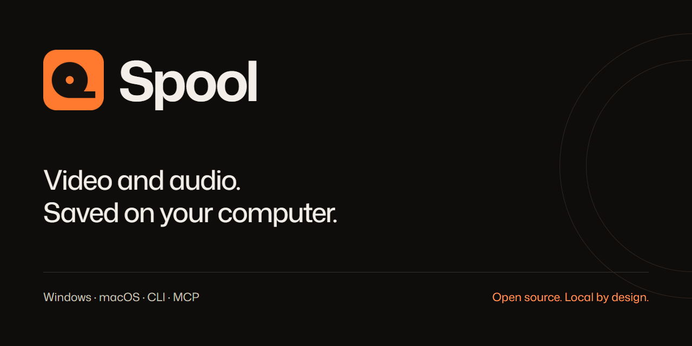
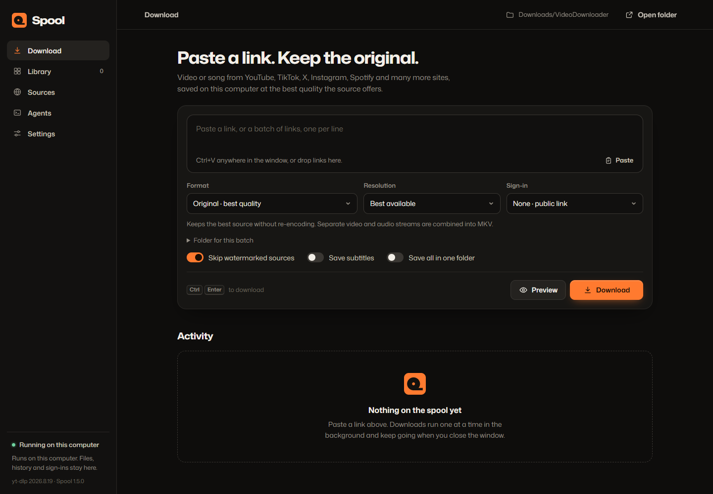

<p align="center"></p>

# Spool

A local video and audio downloader for Windows and macOS. Save source-quality media, manage a persistent queue, and use the same library from the desktop app, a JSON command line or an MCP agent.

[](https://github.com/v2matosevic/spool/actions/workflows/ci.yml)
[](https://github.com/v2matosevic/spool/releases/latest)
[](LICENSE)

**No hosted backend, telemetry, required account or paid API.** Media extraction and downloads contact the source platforms. History, cookies, settings and diagnostic reports stay on your computer.

## Download

[Get the latest release](https://github.com/v2matosevic/spool/releases/latest). Choose the file for your computer; a source archive is not a prebuilt app.

| Computer | Release file | How to open |
| --- | --- | --- |
| Windows 10/11, x64 | `Spool-VERSION-Setup.exe` | Run the per-user installer, then open Spool from Start Menu. |
| Windows portable | `Spool-VERSION-windows-x64.zip` | Extract the entire folder and run `Spool.exe`. Keep `_internal` beside it. |
| Mac with Apple silicon | `Spool-VERSION-macos-arm64.dmg` | Open the DMG and drag Spool to Applications. |
| Mac with Intel | `Spool-VERSION-macos-x86_64.dmg` | Open the DMG and drag Spool to Applications. |

Windows needs Microsoft Edge WebView2 Runtime. Mac packages require macOS 13 or later. Packages are unsigned by a trusted publisher and Mac packages are not Apple-notarized; see [installation](docs/INSTALLATION.md) for safe first-run instructions and the exact verification limits. No automatic updater is included. The release's `SHA256SUMS.txt` and source/provenance archives accompany the downloads.

## Use it

1. Paste one link, or up to 30 individual links, one per line.
2. Choose **Original** to keep the best exposed streams, or **MP4 · widely compatible** for H.264/AAC playback.
3. Choose a folder. Enable **Save all in one folder** for a flat batch; its destination does not change your default folder.
4. Press **Download**. Finished jobs appear in **Library**. Failed or interrupted jobs can be retried.

Remove and Clear hide history entries, with Undo. They never delete media or partial downloads. Windows desktop file dragging permits copying; receiving applications must support file drops. Copy path and Save a copy are also available.



## Features

- Maintained [yt-dlp](https://github.com/yt-dlp/yt-dlp) extractors, with a searchable source catalog. Site support changes upstream; no guarantee covers every URL.
- Best exposed video/audio streams, merged without video re-encoding. Original, MP4, MKV, WebM, source audio, MP3, M4A, FLAC and WAV.
- Persistent jobs, live progress, cooperative cancellation, resumable retries and a searchable library.
- Separate job folders or flat batches with unique filenames that preserve retry destinations.
- Optional subtitle sidecars when available, and explicit opt-in browser sessions or imported cookies for account-only media.
- Spotify track metadata plus a matched YouTube recording. This is **not Spotify audio**; previews show source provenance. Albums and playlists are not expanded.
- Thirteen standard stdio MCP tools and a JSON CLI, sharing the desktop queue.
- Redacted local diagnostics with attempt, request and error references, including offline export.
- Bundled fonts and desktop runtime dependencies; plain HTML/CSS/JavaScript with no frontend build step.

Profiles, full playlists, ongoing live streams and DRM bypass are excluded. A resolution ceiling never upscales a source. Known-watermark filtering selects streams the extractor labels clean; it does not erase embedded logos. FLAC/WAV cannot restore quality lost upstream. Download only media you have permission to save and follow the source's terms.

## Command line and agents

Windows uses the console engine `VideoDownloader.exe` for CLI/MCP and the windowed `Spool.exe` for desktop shortcuts. The stable engine/data identifier preserves upgrade compatibility.

```powershell
.\VideoDownloader.exe --cli status
.\VideoDownloader.exe --cli download 'VIDEO_URL' --format original --wait
.\VideoDownloader.exe --cli download 'VIDEO_URL' --format mp4 --folder 'C:\Media\Batch' --flat --wait
.\VideoDownloader.exe --cli diagnostics --job JOB_ID
.\VideoDownloader.exe --cli mcp-config
```

On Mac, use `/Applications/Spool.app/Contents/MacOS/VideoDownloader`. Source installs use `.venv/Scripts/python.exe desktop.py` on Windows or `.venv/bin/python desktop.py` on Mac. CLI/MCP starts the loopback service when needed; a visible app window is not required. Closing the window leaves the service and downloads available.

[CLI, MCP and HTTP reference](docs/AGENTS.md) · [Queue operations](docs/QUEUE-API.md) · [Privacy and security](SECURITY.md) · [Diagnostics](docs/LOGGING.md)

## Develop

Python 3.10+ is required by source; release builds use Python 3.13. Other Python versions have not all been verified. Install Node.js and FFmpeg/ffprobe separately for source use. Do not recreate an existing virtual environment blindly.

```powershell
python -m venv .venv
.\.venv\Scripts\python.exe -m pip install -r requirements-dev.txt
.\.venv\Scripts\python.exe desktop.py
.\.venv\Scripts\python.exe -m pytest -q
node --check static/app.js
```

On macOS, use `python3` and `.venv/bin/python`. Spotify matching has a separate matching-only environment: `python scripts/setup_spotify.py`. [Build and release guide](docs/BUILDING.md) · [Contributing](CONTRIBUTING.md) · [Architecture](docs/ARCHITECTURE.md) · [Changelog](CHANGELOG.md).

## Open source

Spool's code is GPL-3.0-or-later. Bundled third-party components retain their own licenses. [Third-party notices](THIRD_PARTY_NOTICES.md) explain the engine, FFmpeg, Node, Python, fonts and Spotify helper, and the source archives accompanying binary releases. The orange tape-roll mark is included with the app; the screenshot shows the actual interface with an empty demonstration queue, not personal download history.

Maintained by [Version2](https://version2.hr). Report reproducible bugs through [GitHub Issues](https://github.com/v2matosevic/spool/issues); report vulnerabilities privately through [GitHub security advisories](https://github.com/v2matosevic/spool/security/advisories/new).
