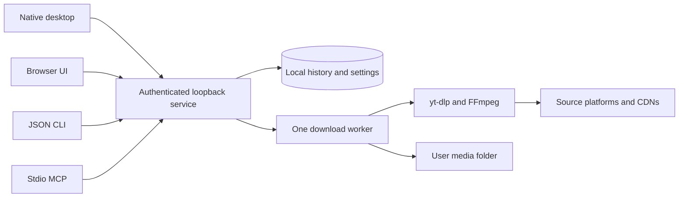

# Architecture and privacy

Native pywebview, the browser interface, JSON CLI and stdio MCP share one Flask/Waitress service bound to 127.0.0.1. SQLite persists the queue, settings and library. A single worker calls yt-dlp, selects exposed streams and asks FFmpeg to merge/extract/convert audio. Node supports upstream extraction challenges. No application cloud service or telemetry is involved.

Windows Spool.exe starts the adjacent console engine without opening a terminal. VideoDownloader.exe remains the agent entry point. macOS wraps the same frozen entry point in Spool.app and uses native WebKit. Closing a window leaves background work available. Concurrent launches bind the socket before recovery so a losing launch cannot rewrite a running queue.

The Spotify helper is an isolated process and environment. It resolves track metadata and matches a YouTube recording; it never downloads Spotify's protected audio. The main queue preserves match provenance and tags the result. Native file dragging is Windows-only and gets validated completed-job paths through the local service.

OS user data is separate from immutable package assets. The local connection descriptor contains a credential. Requests to platforms and thumbnail hosts are normal network activity; no offline claim applies to extraction. Reports are local, redacted and bounded but may still reveal source hostnames or job timing. See SECURITY.md and LOGGING.md for boundaries.
